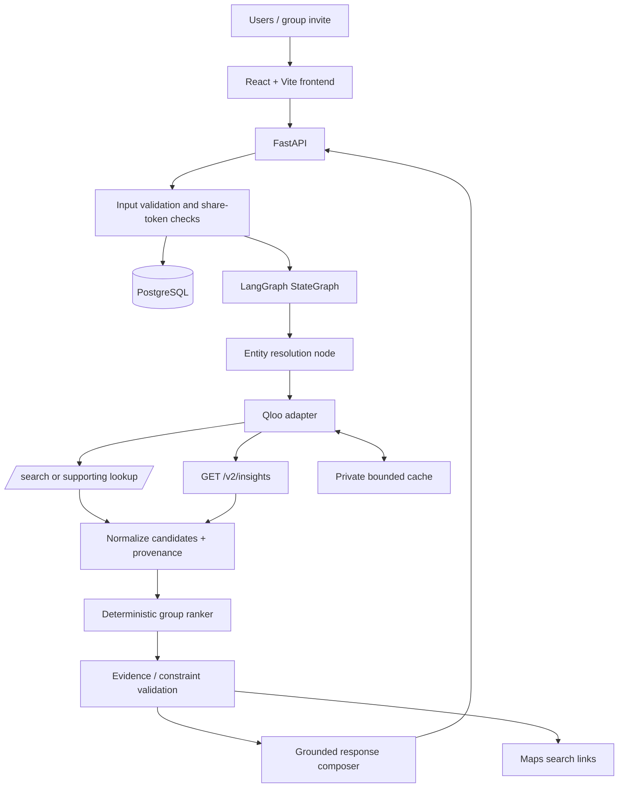

# Common Thread — Product, Architecture & Research Brief

**Version:** 0.2 · **Last reviewed:** 24 October 2026  
**Purpose:** A shared source of truth for product discovery, API validation, architecture decisions and implementation planning for the Qloo Agentic Hackathon.

> **Status:** Design and validation brief, not a frozen product specification. The existing starter repository is a scaffold. Do not assume live Qloo requests, database flows, or end-to-end behavior work until tested.

## How to read this document

We distinguish four evidence classes:

- **DECIDED:** Current working choices agreed for the first implementation.
- **DOCUMENTED:** A capability or rule found in an official public source.
- **HYPOTHESIS:** A product or competitive assumption that still needs testing.
- **OPEN:** A decision that must be settled through evidence, not preference.

Claude Code should read this brief before working, but it should not reproduce the entire brief in every response. It should update the research log and return concise findings with source links and specific consequences for the design.

---

## 1. Executive direction

### Product concept

**Common Thread — the Cultural Bridge Agent** is a consumer-facing agent that helps a small group of people find a shared local experience even when their cultural interests differ.

Rather than averaging everyone's likes or defaulting to popular venues, it uses Qloo's cultural-intelligence API to explore taste-based recommendations, then applies our own deterministic group-ranking rules, practical constraints, and evidence checks to create a small set of well-explained options.

The proposed result types are:

1. **Shared Ground:** options with reasonably strong rank coverage across participants.
2. **Cultural Bridge:** options whose provenance contains credible input-affinity evidence associated with multiple participants.
3. **Stretch Choice:** a less-obvious alternative that still has a defensible connection to at least part of the group's interests.

These labels are conditional. If API evidence does not support a category, the app must use a neutral label such as “Alternative,” rather than manufacture an explanation.

### Main goal

Build a functional, public, externally hosted application where Qloo demonstrably changes the recommendations or discovery workflow. The app must solve a real problem for a real audience, not merely wrap a generic LLM around an API call.

### Long-term vision

If user testing shows value, Common Thread could grow from local group outings into shared cultural discovery for visiting friends, birthdays, dates, student communities, travel experiences or other group decisions. A commercial future might include partnerships with experience providers, but monetisation, partner listings and production Qloo licensing are out of scope until the core product and usage pattern are validated.

### Product principle

**Cultural signals are evidence for discovery, not certainty about a person.** Qloo affinity is not a calibrated probability that a user will enjoy a place. The system must preserve uncertainty, respect explicit constraints, and allow people to disagree with recommendations.

---

## 2. Problem statement and intended audience

### Draft problem statement

People planning shared experiences often struggle to reconcile different tastes. Existing search and recommendation tools can return popular or individually relevant options, but groups still negotiate manually and may settle on generic choices that do not represent everyone. Common Thread accepts a few cultural interests from each participant, uses Qloo to surface relevant cross-domain place recommendations, and combines those signals with a transparent group-ranking strategy to produce balanced and exploratory choices. It explains what evidence informed each option, verifies practical details when a permitted source is available, and adapts to participant feedback. We will compare its outputs against an LLM-only baseline to test whether cultural grounding creates a meaningful advantage.

### Initial audience hypothesis

- Friend groups of two to four people.
- University students and young professionals who plan recurring social activities.
- People visiting a friend or exploring a city together.
- Groups who can share an invitation link and give preferences in under a minute.

This audience is an initial testing hypothesis, not a proven market segment. Validate through short interviews and observed tasks.

### Jobs to be done

- “Help us decide what to do without spending twenty minutes arguing in a group chat.”
- “Give us an option that feels personally relevant, not just popular.”
- “Show me why this choice might work for each person.”
- “Help us discover something new without making the suggestion random.”

### First user workflow

1. A plan creator chooses a city/locality, approximate time window and budget or other hard constraints.
2. The creator shares a short-lived invitation link.
3. Two to four participants add one to three favourite cultural anchors, such as artists, films, games or brands, and optionally explicit dislikes.
4. Ambiguous entity matches are shown to the user for confirmation.
5. The backend queries Qloo within a controlled request budget.
6. A deterministic ranking engine combines per-person rankings and group candidates.
7. Candidates are deduplicated and practical fields are verified where possible. Initially, use Maps search links as a low-dependency handoff; do not claim current hours or availability unless actually verified.
8. The app presents up to three distinct options, reasons supported by data, caveats and a way for participants to reject/refine results.

### MVP success is not “a clever chat response”

Success is a group reaching a useful decision quickly, being able to understand why the options were returned, and seeing a noticeable difference between Qloo-grounded output and a generic LLM-only baseline.

---

## 3. What could make this distinct

The core idea is not group voting; that already exists in other products. The opportunity hypothesis is to create a **cultural bridge** between different people's preferences and make the bridge operationally useful.

Potential differentiators to test:

- A recommendation is selected with individual-level representation in view, not only average group taste.
- The system explores cross-domain affinities, not only obvious overlap in the same category.
- It separates cultural relevance from practical verification.
- It explains provenance without pretending to prove enjoyment.
- It balances familiar choices with a controlled, relevant stretch option.
- It compares its result with a generic LLM baseline and exposes evidence that Qloo mattered.

Do not claim these are unique in the market until the competitor study is complete. They are product hypotheses.

---

## 4. Competitor and substitute research

This is a preliminary competitive map. Public feature pages are not sufficient to prove a competitor has a particular weakness. Conduct a hands-on test or record “not publicly established.” Focus on direct substitutes: users may simply use a group chat, search engine, Google Maps or their existing local-discovery app.

| Product / substitute | Documented or apparent overlap | Research question for Common Thread |
|---|---|---|
| Google Maps Ask Maps | Conversational discovery based on place information and personalized local planning. | Can our Qloo-grounded cultural bridge produce options that are meaningfully different, and does it help a multi-person group rather than a single user? Do not assume Maps cannot do group planning. |
| Yelp Assistant | Local discovery, personalization and actions such as reservations/wait-time assistance announced in 2026. | Does a taste graph across cultural domains add value beyond local reviews, lists and booking integrations? |
| Group Table | Directly targets group restaurant selection and participant preferences. | Is our cross-domain cultural-grounding layer valuable enough to expand beyond dining and outperform a group preference matcher? |
| Quewi | Group/couple/individual movie and TV selection. | What happens when shared cultural discovery crosses out of one media category into real-world experiences? |
| Spotify Blend | Shared music experience based on participants' listening preferences. | Can group-taste ideas be extended into an agent that selects real-world experiences across multiple categories? |
| Manual group chat + Maps/search | Free, familiar, and has little onboarding. | What planning friction is severe enough that people will share a new tool instead? |

### Required competitor study template

For each product, test one comparable task and log:

- Date and region tested; platform/access limitations.
- Inputs required and time to a result.
- How group members contribute preferences.
- Whether individual members can be underserved and how the product exposes that.
- Whether it finds cross-category connections or stays within one category.
- Whether explanations cite evidence or merely describe the recommendation.
- Whether location, open-now, pricing and availability information are verified and current.
- What action completes the workflow.
- What it does well; what was not tested; exact gap hypothesis.

Avoid claims like “competitor X cannot do Y” unless the product was tested under comparable conditions or reliable documentation establishes it.

### Initial reference links

- [Google Maps: Ask anything about any place with Gemini](https://blog.google/intl/en-in/products/explore-communicate/ask-anything-about-any-place-on-maps-with-gemini/)
- [Google Maps: Ask Maps updates in India](https://blog.google/intl/en-in/products/ask-maps-gets-more-helpful-in-india/)
- [Yelp: Fall 2026 product release](https://www.yelp-press.com/press-releases/press-release-details/2026/Yelp-Announces-More-Personalized--Yelp-Assistant-Agent-that-Checks-Restaurant-Wait-Times-and-AI-Tools-for-Service-Professionals/default.aspx)
- [Group Table](https://www.grouptable.ai/)
- [Quewi](https://quewi.app/)
- [Spotify Blend](https://support.spotify.com/article/blend/)

---

## 5. Qloo: documented strengths, boundaries and questions

### Documented by Qloo's hackathon guide

The current hackathon developer guide says:

- The hackathon base URL is `https://hackathon.api.qloo.com`; hackathon keys do not work against staging or production hosts.
- The primary recommendation/insights endpoint is `GET /v2/insights`.
- Entity lookup uses `/search`; tag lookup uses `/v2/tags`.
- `/search` and `/v2/insights` are separate endpoints.
- `filter.type` is required for Insights, and the valid parameters depend on the chosen entity type.
- The guide lists entity types including `artist`, `book`, `brand`, `destination`, `movie`, `person`, `place`, `podcast`, `tv_show`, and `video_game`.
- The key goes in the `X-Api-Key` header.
- Unsupported parameters may be silently ignored; a successful HTTP status with an empty `entities` array can mean the query parameters are invalid for that entity type or coverage is missing.
- Tags and audience values need valid Qloo identifiers/URNs, not arbitrary free text.
- Hackathon keys have rate/monthly quotas and are deactivated after the hackathon judging period.
- Private server-side caching is permitted by the hackathon guide, but Qloo response data must not be copied into a public repository.
- The guide states that the full response is returned; parse and retain only the fields needed by the application.

Source: [Qloo Agentic Hackathon Developer Guide](https://docs.qloo.com/reference/qloo-llm-hackathon-developer-guide) (checked 24 October 2026).

### What Qloo should own

- Resolving cultural names into Qloo entity IDs, with a human confirmation path for ambiguity.
- Providing taste-based recommendation candidates using documented Insights parameters.
- Supplying cultural connection/affinity signals that our application can use as evidence.
- Returning recommendation metadata, including explainability information if available for the actual query.

### What our product must own

- Group-level fairness and aggregation.
- Hard-constraint enforcement.
- Candidate normalization and duplicate detection.
- Deciding which option qualifies as Shared Ground, Cultural Bridge or Stretch Choice.
- Evidence-aware explanations and user feedback.
- Practical venue verification or explicitly marking details unverified.
- Privacy, abuse prevention, usage tracking and graceful failure.

### Critical Qloo hypotheses to validate

1. **Cross-domain support:** Given a mixture of cultural entities, can the Insights endpoint return useful `place` candidates for a selected locality? Check the current entity-type parameter guide for every signal/filter used.
2. **Combined-profile behavior:** Does a query using multiple interest entities return a useful candidate set for group discovery, or should individual profiles be queried separately?
3. **Coverage:** Does the chosen test city have enough useful place coverage for representative interests? Do not select the city until this is measured.
4. **Explainability:** Is explainability supported by the actual query and useful enough to map returned input IDs to participant profiles? How often is the field absent or sparse?
5. **Parameter semantics:** Are returned result ranks/scores comparable across separate requests? Assume they are not comparable until documentation and testing prove otherwise.
6. **Budget:** How many Qloo calls does the proposed group flow use in the worst case, including entity resolution and the one allowed recovery attempt?
7. **License/continuity:** Hackathon API access is temporary. What production access, permitted storage, redistribution and commercial-use terms would apply after the event?

### Minimum live API spike

Use the real event key privately, not a key or payload committed to Git.

1. Verify the key against the hackathon host.
2. Search/resolve a small list of diverse, common entities.
3. Test one documented Insights query with a supported `filter.type` and entity signal.
4. Test a `place` query with a plausible supported input and locality, using the entity-type parameter guide.
5. Test explainability only if the current docs expose the parameter for that request.
6. Record request parameters, status codes, response field names, candidate counts, elapsed time and failure class; redact keys and avoid storing full payloads in public files.
7. Repeat with one combined profile and separate participant profiles.
8. Save a concise contract note, not the entire Qloo response body.

Do not use `/recs` or `/recommendations`; the current hackathon guide explicitly marks them as legacy/unsupported. Do not infer a successful integration merely from a mock response.

---

## 6. Architecture decision: V2

### Decision

Use a **modular monolith with one bounded LangGraph workflow**. Keep separate system and internal-agent diagrams in the repository. The system diagram shows the deployment and provider boundaries; the agent diagram shows the nodes, transitions and stop conditions.

### Proposed stack (free-tier target, not a guarantee)

- **Frontend:** React + Vite + TypeScript; candidate deployment: Cloudflare Pages.
- **Backend:** Python + FastAPI; candidate deployment: Render free web service.
- **Agent orchestration:** LangGraph `StateGraph`, one graph, typed state, deterministic nodes and bounded conditional edges.
- **Persistence:** PostgreSQL, initially Supabase free tier or local SQLite for development. PostgreSQL is the deployed source of truth if using Supabase.
- **Data validation:** Pydantic models.
- **Database layer:** SQLAlchemy and migrations (prefer Alembic before relying on shared deployed state).
- **Provider boundaries:** Qloo adapter and optional LLM adapter; both accessed server-side only.
- **Ranking:** ordinary deterministic Python functions independent of the LLM.
- **Local discovery action:** Maps search links in v1. Defer a paid/billing-enabled place-verification API until required and cost-checked.
- **Tests:** pytest for ranking/workflow/API, frontend type-check/build, contract tests using safe synthetic or redacted fixtures.

Free-tier availability, quotas, cold starts, inactivity pauses and terms can change. Confirm current limits at deployment. Do not promise zero operating cost beyond active free allowances. Render's free web services can sleep after inactivity and have ephemeral filesystems; persistent data must live in a database. Google Places requires billing configuration and is not a guaranteed zero-dollar dependency.

### Logical system diagram

### Internal agent nodes

1. `validate_request` — reject missing or malformed required input before provider calls.
2. `resolve_entities` — resolve interests with Qloo; return ambiguity for user confirmation rather than silently choosing the first match.
3. `retrieve_insights` — query combined and, if justified, individual profiles within a strict call budget.
4. `normalize_candidates` — deduplicate candidate IDs, store request/run provenance and available explanation metadata.
5. `rank_options` — apply deterministic group ranking.
6. `validate_evidence` — enforce hard constraints and ensure all factual claims refer to structured evidence.
7. `compose_response` — use an LLM only to express the validated result if an affordable/available model is configured; otherwise use deterministic templates.
8. `validate_output` — schema-check the final response and remove unsupported claims.

Conditional paths: request clarification, entity confirmation, one bounded recovery query, partial result, provider failure and normal completion. Do not create an unbounded autonomous loop. A single model does not need to control every node.

### Trust boundaries

- Browser never receives Qloo or LLM secrets.
- LLM is not allowed to construct arbitrary URLs, SQL, headers or unregistered tools.
- LLM cannot add new venue candidates, modify rankings or override hard constraints.
- Ranking engine does not depend on the LLM.
- Provider responses are treated as untrusted data and parsed through schemas.
- No claim about live hours, current availability, cost or safety unless a source actually provides it.

---

## 7. Candidate ranking design

### Inputs

- Candidate IDs and per-profile ranking positions.
- Combined-profile candidate set.
- Explicit hard constraints.
- Explainability/provenance records where available.
- User feedback.

### Ranking dimensions

- **Group coverage:** how well the candidate ranks for each participant.
- **Balance/fairness:** whether one participant is consistently unrepresented.
- **Bridge evidence:** whether available provider provenance connects input entities associated with more than one participant.
- **Novelty:** whether the candidate differs from obvious/shared options while maintaining a defensible connection to the group's interests.
- **Constraint validity:** whether all hard constraints are satisfied.
- **Practical confidence:** whether identity and factual details have adequate evidence.

### Algorithm guardrails

- Start with rank-based aggregation (e.g., reciprocal rank / normalized rank), not raw score averages from independent API queries.
- Do not combine ranks from different output categories.
- Penalize a candidate that is absent from a person's list only after testing the meaning of absence; absence may mean missing coverage, not dislike.
- Treat explicit user dislikes as hard exclusions only when clearly specified as such.
- Never call affinity a probability of enjoyment.
- If explainability is missing, do not fabricate per-person causal explanations.
- Enforce diversity between the three selected options so they are not duplicates with slightly different descriptions.
- Keep score components observable for testing; avoid premature ML training.

---

## 8. Initial data model and backend contracts

### Data model candidates

| Table | Purpose | Important considerations |
|---|---|---|
| `plans` | Locality, budget/constraints, expiry and status | Random public ID; expiry policy; no sensitive data by default. |
| `participants` | Alias and plan membership | Store a hash of a random join token, never the raw secret token. |
| `preferences` | Confirmed entity IDs, labels, participant ID | Store only what the group needs; consent-aware visibility. |
| `recommendation_runs` | Run state, idempotency key, error code and timestamps | Avoid duplicate expensive requests after client retries. |
| `recommendations` | Candidate ID, rank, option class, score components and provenance | Do not store unnecessary full provider payloads. |
| `feedback` | Participant/candidate vote or rejection reason | Minimal event data; expire with the plan unless user consents to retention. |
| `qloo_cache` (optional) | Private request hash, minimal response/cache value and TTL | Cache policy must comply with current API terms; do not publish cached responses. |

### Candidate application endpoints

- `GET /api/health` — basic health and mock/live mode; never reveal environment variables.
- `POST /api/plans` — create a plan.
- `POST /api/plans/{id}/participants` — join via token.
- `PUT /api/plans/{id}/preferences` — update participant preferences.
- `POST /api/plans/{id}/recommendations` — start or retrieve an idempotent run.
- `POST /api/plans/{id}/feedback` — submit vote/rejection/refinement feedback.
- `GET /api/plans/{id}` — retrieve status and current results.

The starter's current direct recommendation endpoint is a scaffold path, not evidence the whole group-plan lifecycle is implemented. Inspect the code before assuming the endpoints exist. Implement one end-to-end slice rather than wiring every endpoint separately without integration tests.

### Persistence choice

PostgreSQL is the deployed source of truth. The LangGraph state is execution state, not a competing product database. Do not add a LangGraph checkpointer in the first iteration unless pause/resume across restarts is a demonstrated requirement. Do not add Redis, a vector database, a task queue or microservices before need is proven.

---

## 9. Reliability, privacy and operating rules

### Resilience

- Explicit connection and response timeouts for all external calls.
- Retry only transient failures; do not retry authentication failures or invalid parameters automatically.
- One recovery query at most for insufficient candidates, subject to a per-run Qloo call budget.
- Distinguish empty result, malformed response, rate limit, authentication error and upstream timeout.
- Preserve partial valid candidates if policy allows; return a clear warning instead of manufacturing results.
- Idempotent recommendation runs to protect against duplicate browser submissions.
- Stable provider adapters and mocks for deterministic tests.
- Structured logs with run IDs and error classes; no secrets or personal interest payloads in routine logs.

### Privacy and security

- Short-lived anonymous plans for v1; no compulsory account.
- Store the hash of the share token; use cryptographically random tokens and prevent cross-plan access.
- Define expiry/deletion; collect the minimum necessary personal data.
- Validate input size, number of participants and interest count.
- Rate-limit plan creation and recommendation requests.
- Restrict CORS to the deployed frontend domain.
- Keep `.env` and credentials outside Git; use host secret settings.
- Do not place Qloo responses in the public repository; use synthetic fixtures for tests.
- Check license/terms for every external API, library and dataset.

### Cost controls

- Limit group size initially to two to four participants and one to three interests each.
- Count Qloo calls per run; cache entity resolution where permitted.
- Do not query Google Places in v1 if billing configuration would compromise the $0-target.
- Keep the LLM optional; deterministic templates must let the demo run when the LLM provider is unavailable.
- Use a configurable LLM adapter and choose a current provider only after checking current free quota, structured output/tool-call compatibility, rate limits, data terms and regional availability.
- Free-tier infrastructure is suitable for a hackathon demo, not a claim of commercial reliability.

---

## 10. Evaluation and go/no-go experiment

The project must prove that Qloo does useful work in the loop. Build a reproducible evaluation set with synthetic group profiles (do not make public fixtures from restricted live Qloo payloads).

### Compare three variants

A. **LLM-only baseline:** same group preferences and constraints, no Qloo response.  
B. **Combined Qloo query:** Qloo-powered candidates from a combined signal, then our ranking.  
C. **Qloo plus individual profile queries:** candidates from combined and participant profiles, then the same ranking method.

Use identical input profiles and identical hard constraints. Record the query plan and API request count.

### Proposed evaluation measures

- Entity-resolution success and ambiguity rate.
- Candidate count and duplicate rate after normalization.
- Coverage/representation per participant.
- Worst-participant rank or coverage, to expose unfair recommendations.
- Cross-profile provenance: whether explanation metadata (when available) supports a bridge label.
- Diversity among selected options.
- Hard-constraint violation rate (must be zero after validation).
- Practical-place match/verification success if a verifier is used.
- Time to useful result and Qloo/LLM calls per run.
- Blind tester ratings: relevance, novelty, trust and choice confidence.

### Initial go/no-go thresholds (provisional)

These are proposed project thresholds, not Qloo guarantees or judging criteria. Adjust them after a pilot and explain every change.

- At least 80% of selected test inputs resolve unambiguously, or a good correction flow exists.
- Each test group can produce at least five unique candidates on the chosen target location/profile set, unless a defensible sparse-result UX is chosen.
- At least two of three deliberately different group scenarios produce a plausible, data-supported cross-profile candidate; otherwise change the “Cultural Bridge” claim or simplify the product.
- Hard-constraint violations in displayed results: zero.
- Every factual explanation traces to normalized structured evidence; unsupported explanations: zero.
- There is at least one clear case where Qloo changes the option set or provides relevant evidence not present in the LLM-only baseline. If not, redesign before polishing UI.

### Example test profiles

Use 2–4 participants. Pick interests from multiple supported categories. Test:

- Similar cultural tastes, different practical constraints.
- Disjoint tastes with one possible shared bridge.
- One participant with sparse or unresolved interests.
- One explicit exclusion (e.g., not a loud venue) and one budget cap.
- A group whose profiles do not produce enough Qloo results.
- Qloo timeout/rate-limit/empty response.

Use synthetic inputs first and actual Qloo calls only for a bounded validation spike. Select the initial test city based on measured API coverage, not assumption.

---

## 11. Business and product validation

### Main commercial hypothesis

A group creator will share a link if the product reduces decision friction and delivers relevant, fresh options with little onboarding. This could create organic distribution: one creator invites multiple participants, but this loop has to be measured.

### Questions to answer before assuming a business

- How often do the target users have this problem?
- How do they solve it now (group chat, maps, search, social feeds, voting apps)?
- Which moment makes them willing to try a separate tool?
- Will each participant enter interests, or is that too much friction?
- Does the first plan complete in under a minute or two?
- Do groups select a recommendation or reject all options?
- Do the same groups return for another occasion?
- Is local discovery too crowded for this use case to spread organically?
- What does a sustainable cost per completed plan look like if API and LLM costs later become payable?
- What Qloo production licensing and continuity options would be necessary after hackathon access expires?

### Monetisation is a later hypothesis

Possible later routes are free consumer utility, transparently disclosed booking/referral partnerships, or a business-facing service for experience providers. Do not build payment flows during the hackathon. Do not sell ranked placement in a way that secretly alters relevance. First establish repeated user value and production data/API rights.

### Metrics

- Median time from link creation to useful choices.
- Invite-to-participant submission rate.
- Percentage of plans where the group selects one option.
- Per-person representation in selected options.
- Rate of users choosing the Cultural Bridge or Stretch Choice options.
- Repeat use by the same group over time.
- Difference in blind preference ratings between Qloo-grounded and LLM-only results.

For a hackathon, a small evaluation is useful directional evidence; it is not proof of product-market fit.

---

## 12. Current starter repository: known work to check

The starter README currently describes a scaffold with mock mode, FastAPI, LangGraph, Qloo adapter, deterministic ranking, SQLAlchemy models and a frontend. It explicitly warns that live Qloo parameter/response assumptions are not yet verified.

The current repo notes these limitations; verify them against code at the start of the next session:

- The direct recommendation flow exists as a starting point, but plan creation/join routes and the full share-link workflow are not wired.
- Entity resolution currently takes the first match; add a user-confirmation path before live public use.
- The optional LLM composer is explanation-focused, not an open-ended agent loop.
- Live Qloo request parameter names and response shapes need contract testing.
- Database models are scaffolded; migrations should be added before shared deployed data is relied upon.
- Place verification is deliberately deferred; Maps search links are not proof of current details.
- The full test suite and frontend production build were not confirmed in the initial handoff; run commands and report actual results instead of assuming success.

First do a read-only audit: what genuinely builds, runs and passes tests? Do not rewrite working modules before verifying the current implementation.

---

## 13. Hackathon and deployment constraints

The official Devpost rules currently specify:

- A functional demo application hosted externally.
- A public repository with source, assets and instructions.
- An open-source license file visible on the repository page/About section.
- A written project description.
- The project must integrate Qloo meaningfully and run as described.
- Four equally weighted criteria: technological implementation, design, potential impact and quality of idea; a preliminary pass/fail check assesses fit and API use.
- Submission deadline currently listed as **30 October 2026, 11:45 p.m. EDT**, which is **31 October 2026, 9:15 a.m. IST**. Re-check the official page immediately before submission in case rules change.

Sources: [Official rules](https://qloo.devpost.com/rules) and [hackathon overview](https://qloo.devpost.com/).

The hackathon API key is temporary through the judging period, so any commercial vision beyond the event requires separate production-access and licensing validation. Keep the Qloo adapter isolated for this reason.

### Deployment shortlist

- Frontend: Cloudflare Pages static hosting, subject to current Free plan limits.
- Backend: Render free web service, if cold starts and free limits are acceptable for the demo.
- Data: Supabase free Postgres or another compliant free-tier PostgreSQL host. Verify inactivity/pausing and backup limitations.
- Domain: use provider-provided subdomains initially.
- If the demo has a cold start, show a clear loading state and provide a retry.

Do not say “free forever.” Describe the plan as “targets free-tier hosting within current limits.”

---

## 14. Research and implementation sequence

Given the deadline, research must be time-boxed. Do not spend the remaining window building an endless strategy document.

### Phase 0 — read-only audit and evidence collection

1. Inspect the repo tree and docs, then examine only relevant source files.
2. Run the existing backend tests, frontend type check and production build if dependencies are available.
3. Create a short issue list: verified defect, missing feature, unverified assumption, risk.
4. Read the current Qloo hackathon guide and specific parameter guide linked from it.
5. Run the minimum Qloo API spike; record results without publishing payloads.
6. Compare the three retrieval strategies on 3 synthetic group profiles.
7. Perform a focused competitor check on 3–5 alternatives and document only observable facts.
8. Recommend go/no-go and lock the minimal scope.

### Phase 0 deliverables

- `docs/RESEARCH_AND_DESIGN_FINDINGS.md` with source URLs, dates, findings and design consequences.
- `docs/API_SPIKE_REPORT.md` with sanitized test cases, parameter names, counts and failure classes, not credentials or full Qloo payloads.
- A prioritized blocker list.
- A short, revised implementation plan with tasks estimated as S/M/L.
- Decision log: what changed, why and what evidence supports it.

### Phase 1 — build the vertical slice

Create one plan with two participants, resolve interests, retrieve Qloo candidates, rank options, produce evidence-backed options and let the user reject/refine one option. Keep mock mode functional. Add tests as each module is changed.

### Phase 2 — make the experience complete

Share link and participant flow, result cards, constraint explanations, feedback, loading/error states, responsive UI and clean demo content.

### Phase 3 — deploy and demonstrate

Live Qloo path, backend secrets, correct CORS, public demo, public repository, licence/About visibility, setup instructions, short demo video and final criteria checklist.

### Time discipline

First pass should be a bounded audit/research session, not a full autonomous implementation. Because the submission deadline is close, target no more than a few hours for API/market validation; make a decision quickly if the evidence is enough. Prioritize a reliable, complete, narrowly scoped demo over advanced architecture.

---

## 15. Decision log

| Decision | Status | Notes / trigger to revisit |
|---|---|---|
| Product working name: Common Thread | DECIDED provisionally | Can change if better name emerges; do not spend time naming now. |
| Core problem: group cultural discovery / local shared experience | LEADING HYPOTHESIS | Must validate user pain and Qloo cross-domain usefulness. |
| Audience: general public; initial test with small friend groups | DECIDED for MVP testing | Segment based on user interviews. |
| Group size: 2–4, interests 1–3 each | DECIDED provisional limit | Tune to call budget and UX. |
| Qloo is central to candidate generation | REQUIREMENT | Fail project hypothesis if removing Qloo does not materially weaken output. |
| One bounded LangGraph workflow | DECIDED | No multi-agent swarm. |
| Deterministic group ranking | DECIDED | Algorithm and weights remain open pending tests. |
| PostgreSQL source of truth | DECIDED | SQLite allowed for local mock development; do not rely on SQLite files on ephemeral hosting. |
| No vector DB, Redis, queue or microservices in v1 | DECIDED | Add only if evidence shows a requirement. |
| Place provider: Qloo output + Maps links initially | DEFAULT | Revisit only if result trust suffers and budget/terms allow verification. |
| First target city | OPEN | Choose after API coverage test. |
| LLM vendor/model | OPEN | Must be configurable; check free quota, tool calls, privacy and data terms. |
| Exact Qloo signal parameters and explainability | OPEN | Follow current docs and actual live responses. |
| Production Qloo licence and business model | OPEN / OUT OF HACKATHON MVP | Ask Qloo separately; hackathon keys are temporary. |
| LangGraph checkpoint persistence | DEFERRED | Add only if resume after interruption is essential. |
| Long-term user accounts | DEFERRED | Prefer expiring anonymous plans until retention is proven. |
| Google Places API | DEFERRED | Requires billing configuration; not a guaranteed zero-dollar dependency. |

---

## 16. Sources to check before final design freeze

Use official documentation first. Record date accessed and the specific question each source resolved.

1. [Qloo Agentic Hackathon Developer Guide](https://docs.qloo.com/reference/qloo-llm-hackathon-developer-guide) — hackathon host, supported endpoint flow, parameters, quotas, key expiration and cache/publication rules.
2. [Qloo API documentation](https://docs.qloo.com/) — parameter details and type-specific support.
3. [Qloo Agentic Hackathon rules](https://qloo.devpost.com/rules) — scope, deliverables, deadline, IP and judging criteria.
4. [LangGraph Graph API](https://docs.langchain.com/oss/python/langgraph/graph-api) — StateGraph, state schemas, nodes, edges and compilation.
5. [Anthropic Claude Code documentation](https://docs.anthropic.com/en/docs/claude-code/getting-started) and [prompting best practices](https://docs.anthropic.com/en/docs/build-with-claude/prompt-engineering/prompt-templates-and-variables) — cloud session workflow, context discipline and tool usage.
6. [Cloudflare Pages limits](https://developers.cloudflare.com/pages/platform/limits/) — current free-tier hosting constraints.
7. [Render free services](https://render.com/docs/free) — cold starts, ephemeral filesystem and free-tier limitations.
8. [Google Places API overview](https://developers.google.com/maps/documentation/places/web-service/op-overview) and [pricing/usage](https://developers.google.com/maps/documentation/places/web-service/usage-and-billing/) — evaluate later only if place verification becomes necessary.
9. [Google Maps Ask Maps announcement](https://blog.google/intl/en-in/products/explore-communicate/ask-anything-about-any-place-on-maps-with-gemini/) and [India updates](https://blog.google/intl/en-in/products/ask-maps-gets-more-helpful-in-india/).
10. [Yelp Fall 2026 product release](https://www.yelp-press.com/press-releases/press-release-details/2026/Yelp-Announces-More-Personalized--Yelp-Assistant-Agent-that-Checks-Restaurant-Wait-Times-and-AI-Tools-for-Service-Professionals/default.aspx), [Group Table](https://www.grouptable.ai/), [Quewi](https://quewi.app/), [Spotify Blend support](https://support.spotify.com/article/blend/).

---

## 17. Definition of ready to freeze the design

Do not call the design final until all of these have a clear answer:

- [ ] One real user pain is described and supported by lightweight research.
- [ ] The first target city is selected from actual Qloo coverage, not guesswork.
- [ ] One entity search and one Insights request have been tested live.
- [ ] The exact type-specific parameters are verified against Qloo documentation.
- [ ] At least one test demonstrates a Qloo-derived difference vs LLM-only output.
- [ ] The app distinguishes observed provider evidence from model-generated explanation.
- [ ] Ranking behavior is tested for 2–4 people, missing candidates, duplicate candidates and a repeatedly underserved participant.
- [ ] API call counts, retries, timeouts and rate limiting are bounded.
- [ ] The MVP feature list fits the remaining schedule.
- [ ] Public demo, repository, licence and submission text are accounted for.
- [ ] Known limitations and production licensing dependencies are documented.

If a critical Qloo hypothesis fails, revisit the product scope before trying to compensate with more agents or more APIs.
